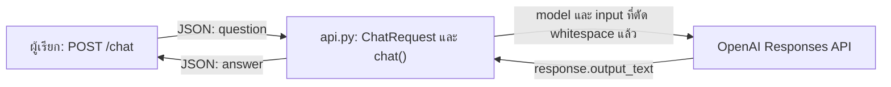

# Skill Playground

พื้นที่ตัวอย่างสำหรับ Skills และ API ถามตอบด้วย FastAPI ซึ่งรับคำถามผ่าน `POST /chat` ส่งไป OpenAI Responses API และคืนคำตอบเป็น JSON

เริ่มอ่านรายละเอียดที่ **[คู่มือ API](docs/api.md)** ซึ่งรวมการตั้งค่า ตัวอย่าง Request/Response แผนภาพการทำงาน และ Troubleshooting

## สถานะการตรวจสอบ

- **ตรวจจากโค้ดแล้ว:** [api.py](api.py), schema `ChatRequest` และขั้นตอนใน `chat()`
- **ยังไม่ได้ทดสอบจริง:** การติดตั้ง การเปิด server และการเรียก API
- **ยังไม่ยืนยัน:** เวอร์ชัน dependencies สิทธิ์โมเดล และการ render แผนภาพบน GitHub

## องค์ประกอบของโปรเจกต์

| ไฟล์/โฟลเดอร์ | หน้าที่ |
|---|---|
| [api.py](api.py) | API ถามตอบ: รับ `question` และคืน `answer` |
| [docs/api.md](docs/api.md) | คู่มือการทำงาน วิธีรัน ตัวอย่าง API และการแก้ปัญหา |
| [code-documentation/SKILL.md](code-documentation/SKILL.md) | Skill สำหรับสร้างเอกสารจากโค้ดจริง |
| [rag-answer-review/SKILL.md](rag-answer-review/SKILL.md) | Skill สำหรับตรวจคำตอบกับ Context ที่กำหนด |

Skills เป็นคำแนะนำสำหรับผู้ช่วย ไม่ใช่โมดูลที่ `api.py` เรียกใช้ API นี้ไม่มีขั้นตอนดึง Context หรือทำ RAG ในโค้ด

## ภาพรวมการทำงานของ API



ภาพแสดงเส้นทางเมื่อสำเร็จใน [api.py](api.py): `ChatRequest` ตรวจ request ก่อน `chat()` ตัด whitespace และเรียก OpenAI หากคำถามว่างจะคืน HTTP 400 โดยไม่ส่งคำถามไปบริการ อ่านเส้นทาง validation และ exception ใน [แผนภาพฉบับละเอียด](docs/api.md#workflow)

## เริ่มต้นใช้งาน API

คำสั่งต่อไปนี้เป็นแนวทางสำหรับ **PowerShell** โดยใช้โฟลเดอร์ที่มี `api.py` เป็น working directory ยังไม่ได้ทดสอบกับ environment จริง และโปรเจกต์ยังไม่มีไฟล์ตรึงเวอร์ชัน dependencies

### 1. เตรียม Python environment

ต้องมี Python ที่ใช้งานร่วมกับแพ็กเกจที่เลือกได้ คำสั่งนี้จะสร้าง `.venv` และติดตั้งแพ็กเกจลงใน environment นั้น:

```powershell
python -m venv .venv
.\.venv\Scripts\python.exe -m pip install fastapi pydantic openai uvicorn
```

### 2. ตั้งค่า environment variables

| ตัวแปร | หน้าที่ |
|---|---|
| `OPENAI_API_KEY` | API Key ที่ OpenAI SDK อ่านขณะสร้าง client ก่อนเริ่ม server |
| `OPENAI_MODEL` | ชื่อโมเดลที่รองรับ Responses API และบัญชีเข้าถึงได้ |

ตั้ง API Key ผ่าน environment ของ process อย่างปลอดภัย ไม่บันทึก key ลงโค้ดหรือเอกสาร ส่วนโมเดลกำหนดใน shell เดียวกับที่จะเปิด server โดยแทน placeholder ก่อนใช้:

```powershell
$env:OPENAI_MODEL = '<ชื่อโมเดลที่บัญชีเข้าถึงได้>'
```

โค้ดไม่ได้โหลด `.env` เอง ดูรายละเอียดและวิธีตรวจว่าตั้งค่าแล้วโดยไม่แสดงค่าลับใน [การเตรียมระบบ](docs/api.md#setup)

### 3. เปิด server สำหรับพัฒนา

```powershell
.\.venv\Scripts\python.exe -m uvicorn api:app --host 127.0.0.1 --port 8000 --reload
```

`api:app` อ้างตัวแปร `app` ใน `api.py` ส่วน `--reload` ใช้สำหรับพัฒนา การรัน `python api.py` อย่างเดียวไม่ได้เปิด server

### 4. ส่งคำถาม

เมื่อ server พร้อม ตัวอย่างนี้จะส่งคำถามไป OpenAI จริงและอาจมีค่าใช้บริการ:

```powershell
$body = @{ question = 'สวัสดี' } | ConvertTo-Json
Invoke-RestMethod -Method Post -Uri 'http://127.0.0.1:8000/chat' `
    -ContentType 'application/json; charset=utf-8' `
    -Body ([System.Text.Encoding]::UTF8.GetBytes($body))
```

ตัวอย่าง JSON response เมื่อสำเร็จ ข้อความเป็นข้อมูลสมมุติ ไม่ใช่ผลทดสอบและไม่รับประกันคำตอบตายตัว:

```json
{"answer":"สวัสดีครับ มีอะไรให้ช่วยบ้างครับ"}
```

## เอกสารและการแก้ปัญหา

- [ลำดับการทำงานและแผนภาพ](docs/api.md#workflow)
- [Request/Response และ Error cases](docs/api.md#examples)
- [Troubleshooting](docs/api.md#troubleshooting)
- [ข้อจำกัดและข้อมูลที่ยังไม่ทราบ](docs/api.md#limitations)

หากเริ่ม server ไม่ได้ ให้ตรวจ Python environment และ `OPENAI_API_KEY` ก่อน หากคำถามไม่ว่างล้มเหลว ให้ตรวจ `OPENAI_MODEL` และ exception ฝั่ง server แอปยังไม่มี error mapping สำหรับ OpenAI และไม่ได้กำหนด authentication ของผู้เรียก `/chat` ในโค้ดนี้
