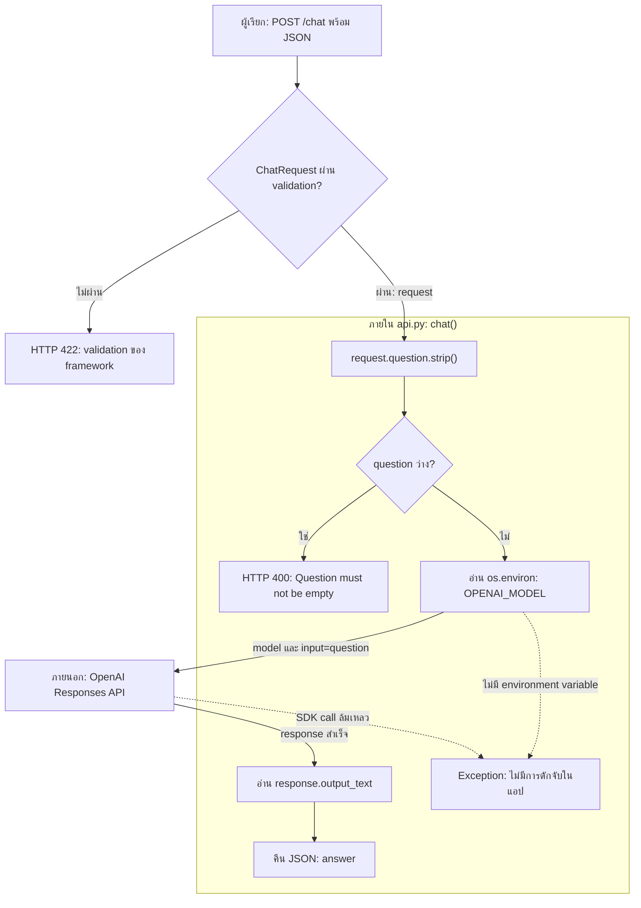
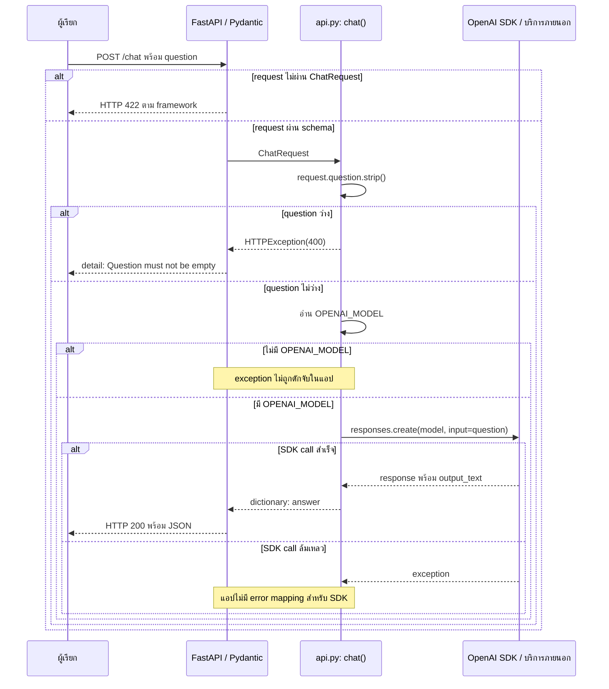

# คู่มือ API: `api.py`

คู่มือการรับคำถาม ส่งต่อไปยัง OpenAI และวิเคราะห์ปัญหาของ `POST /chat`

| สถานะการตรวจสอบ | รายละเอียด |
|---|---|
| ตรวจจากโค้ดแล้ว | [api.py](../api.py): `ChatRequest`, `chat()`, การสร้าง client และ environment variables |
| ทดสอบจริงแล้ว | ยังไม่ได้รันระบบ ติดตั้ง dependencies หรือส่ง request |
| ยังไม่ยืนยัน | เวอร์ชันที่ติดตั้ง สิทธิ์โมเดล ผลลัพธ์จริง และการ render Mermaid บน GitHub |

## สารบัญ

- [1. ภาพรวม](#overview)
- [2. ไฟล์และองค์ประกอบที่เกี่ยวข้อง](#components)
- [3. ลำดับการทำงานและแผนภาพ](#workflow)
- [4. คลาสและฟังก์ชันสำคัญ](#functions)
- [5. การเตรียมระบบและวิธีรัน](#setup)
- [6. ตัวอย่าง Request/Response](#examples)
- [7. Troubleshooting](#troubleshooting)
- [8. ข้อจำกัดและข้อมูลที่ยังไม่ทราบ](#limitations)
- [เอกสารทางการประกอบ](#references)

<a id="overview"></a>

## 1. ภาพรวม

[api.py](../api.py) เป็นเว็บ API ด้วย FastAPI สำหรับรับคำถามผ่าน `POST /chat` ส่งไปยัง OpenAI Responses API และคืนข้อความคำตอบ เหมาะสำหรับเป็น backend ของหน้าจอถามตอบอย่างง่าย

เอกสารครอบคลุม `ChatRequest`, `chat()`, การตั้งค่า OpenAI client และวิธีเปิดแอปด้วย ASGI server โดยอ้างอิงการอ่านโค้ด ข้อมูลที่ขึ้นกับบริการภายนอกและตัวอย่างที่ยังไม่ทดสอบระบุแยกไว้ในแต่ละส่วน

ไม่พบ README, ไฟล์ dependencies/lockfile, `.env.example`, Log หรือเอกสารการรันใน workspace ที่ตรวจ จึงยังยืนยันเวอร์ชัน Python และแพ็กเกจที่ใช้งานจริงไม่ได้ คำสั่งด้านล่างเป็นแนวทางที่อนุมานจาก imports และ `app` ในโค้ด ไม่ใช่คำสั่งที่ผ่านการทดสอบในโปรเจกต์นี้

<a id="components"></a>

## 2. ไฟล์และองค์ประกอบที่เกี่ยวข้อง

| ไฟล์/โมดูล | หน้าที่ | ความเกี่ยวข้อง |
|---|---|---|
| [api.py](../api.py) | ประกาศแอป schema และ endpoint | โค้ดระบบทั้งหมดที่ตรวจพบในขอบเขตนี้ |
| `os` | อ่าน environment | ใช้ `os.environ["OPENAI_MODEL"]` ใน `chat()` |
| `fastapi.FastAPI` | สร้างแอปและลงทะเบียน route | ตัวแปร `app` และ `@app.post("/chat")` |
| `fastapi.HTTPException` | ยุติ request ด้วย HTTP error | คืน 400 เมื่อคำถามว่างหลังตัดช่องว่าง |
| `pydantic.BaseModel` | ประกาศ schema ของ request | คลาส `ChatRequest` มี `question: str` |
| `openai.OpenAI` | client สำหรับ OpenAI | สร้าง `client` ระดับโมดูลและเรียก `responses.create()` |
| Uvicorn | ASGI server ที่เลือกใช้ในคู่มือนี้ | เป็นข้อเสนอสำหรับรัน `api:app` ไม่ได้ถูก import ในโค้ด |

ไม่มีการเรียกโมดูลภายในอื่น ไม่มีการเชื่อม Database และไม่มีคำสั่งเขียนไฟล์ใน `api.py` คำถามถูกส่งไปบริการ OpenAI ภายนอก

<a id="workflow"></a>

## 3. ลำดับการทำงาน

### การเริ่มแอป

เมื่อ ASGI server import โมดูล `api` จะสร้าง `app = FastAPI()` และ `client = OpenAI()` ทันที จากนั้นลงทะเบียน `POST /chat` การตั้งค่า API Key จึงต้องพร้อมก่อนเริ่ม server

ขั้นตอนนี้ยังไม่ส่งคำถามไป OpenAI ส่วน `OPENAI_MODEL` จะถูกอ่านภายหลังใน `chat()` เฉพาะเมื่อคำถามไม่ว่าง การไม่มี API Key จึงอาจทำให้โหลดแอปไม่สำเร็จ ขณะที่การไม่มีชื่อโมเดลจะกระทบ request ที่ผ่านการตรวจคำถามว่างแล้ว

### การประมวลผลคำถาม

1. ผู้เรียกส่ง JSON ที่มี `question` มายัง `POST /chat`
2. FastAPI/Pydantic ตรวจ request ตาม `ChatRequest` ก่อนเรียก `chat()` หาก schema ไม่ผ่าน จะเป็นเส้นทาง validation ของ framework ไม่ใช่เงื่อนไขคำถามว่างในฟังก์ชัน
3. `chat()` ใช้ `request.question.strip()` ตัด whitespace ด้านหน้าและด้านท้าย โดยไม่แก้ช่องว่างภายในข้อความ
4. หากเหลือข้อความว่าง จะ raise `HTTPException(status_code=400, detail="Question must not be empty")` และไม่เรียก OpenAI
5. หากไม่ว่าง อ่านชื่อโมเดลจาก `os.environ["OPENAI_MODEL"]` ไม่มีค่า fallback ในโค้ด
6. เรียก `client.responses.create(model=..., input=question)` แบบ synchronous และไม่ขอสตรีม
7. อ่าน `response.output_text` และคืน `{"answer": ...}` ให้ FastAPI ส่งเป็น JSON

### ภาพที่ 1: จุดตรวจสอบและเส้นทางข้อมูล

ภาพนี้แยกการตรวจ schema ของ framework ออกจากเงื่อนไขในแอป และแสดงว่าจุดใดอาจล้มเหลวก่อนหรือระหว่างเรียกบริการภายนอก



| องค์ประกอบในภาพ | โค้ดที่เกี่ยวข้อง | รายละเอียดและจุดตรวจ |
|---|---|---|
| `ChatRequest` | [api.py](../api.py): `class ChatRequest(BaseModel)` | `question: str` เป็น field จำเป็น; 422 เป็นพฤติกรรม framework ไม่ใช่ HTTPException ที่แอปเขียนเอง |
| การตัดช่องว่างและ HTTP 400 | [api.py](../api.py): `chat()` | ตรวจหลัง `strip()` จึงปฏิเสธข้อความที่มีแต่ whitespace ก่อนเรียกบริการ |
| `OPENAI_MODEL` | [api.py](../api.py): `os.environ["OPENAI_MODEL"]` | ไม่มี fallback; ถ้าไม่ได้ตั้งค่า request จะล้มที่จุดนี้ |
| OpenAI และ `output_text` | [api.py](../api.py): `client.responses.create()` และ `return` | ส่งเฉพาะชื่อโมเดลกับคำถาม แล้วนำข้อความมาคืนใน field `answer` |
| Exception | [api.py](../api.py): `chat()` | ไม่มี `try/except` สำหรับ configuration หรือ SDK; ไม่ได้รับประกัน error body แบบเฉพาะของแอป |

### ภาพที่ 2: ลำดับ Request/Response ข้ามบริการ

ภาพนี้เริ่มหลังโหลดแอปสำเร็จแล้ว เพื่อให้เห็นว่าการตรวจใดเกิดก่อนการเรียก OpenAI และข้อมูลใดถูกส่งกลับ โดยเส้นประเป็นการตอบกลับหรือรายงานข้อผิดพลาด ไม่ใช่การ retry



`FastAPI / Pydantic` ทำ validation ก่อนเข้า [api.py](../api.py): `chat()` ส่วนการอ่าน `OPENAI_MODEL` และการเรียก `responses.create()` อยู่ภายในฟังก์ชันนี้ทั้งหมด กรณี exception ภาพจึงไม่กำหนด response body เอง เพราะโค้ดไม่มี handler รองรับ ไม่ควรตีความว่า upstream error จะถูกส่งต่อด้วย status เดิม

### รายละเอียดการเปลี่ยนรูปข้อมูล

| ต้นทาง | การประมวลผลใน [api.py](../api.py) | ปลายทาง |
|---|---|---|
| JSON field `question` | ตรวจด้วย `ChatRequest` | `request.question` |
| `request.question` | `.strip()` ใน `chat()` | ตัวแปร `question` ซึ่งส่งเป็น `input` |
| Environment `OPENAI_MODEL` | อ่านด้วย `os.environ[...]` | พารามิเตอร์ `model` ของ `responses.create()` |
| OpenAI response | อ่าน `response.output_text` | JSON field `answer` |

ตัวอย่างการแปลงข้อมูลสมมุติ: `{"question":"  สวัสดี  "}` → `input="สวัสดี"` → `{"answer":"ข้อความจากโมเดล"}` โดยข้อความคำตอบเปลี่ยนแปลงได้ ไม่ใช่ผลทดสอบจริง

โค้ดส่งเฉพาะคำถามปัจจุบัน ไม่มีการส่งประวัติสนทนา Context สำหรับ RAG หรือ `previous_response_id` และไม่ได้คืนจำนวน tokens ให้ผู้เรียก

<a id="functions"></a>

## 4. คลาสและฟังก์ชันสำคัญ

| ส่วน | หน้าที่และ Input | Output / ผลกระทบ |
|---|---|---|
| `ChatRequest(BaseModel)` | รับ `question: str` ซึ่งไม่มี default | เป็น request model; ไม่ได้กำหนดความยาวขั้นต่ำหรือสูงสุดไว้ |
| `chat(request: ChatRequest)` | รับ model ที่ผ่าน validation แล้ว ตัด whitespace และตรวจข้อความว่าง | คืน dictionary ที่มี `answer`; อาจ raise HTTPException หรือ exception ที่ไม่ได้จัดการ |
| `client = OpenAI()` | สร้าง client ตอน import โมดูล โดย SDK อ่าน `OPENAI_API_KEY` | ต้องมี credentials ก่อนเริ่มแอป; ไม่ได้ส่งคำถามในขั้นตอนนี้ |
| `client.responses.create(...)` | รับชื่อโมเดลจาก environment และคำถามที่ตัดช่องว่างแล้ว | เรียกบริการภายนอก ซึ่งอาจมีค่าใช้บริการตามบัญชีและโมเดล; ได้ response สำหรับอ่าน `output_text` |

ไม่ได้กำหนด `response_model`, timeout, retry หรือ error mapping เองในแอป พฤติกรรมของ SDK ที่ไม่ได้ระบุในโค้ดขึ้นกับเวอร์ชันและค่าเริ่มต้นของ SDK

<a id="setup"></a>

## 5. การเตรียมระบบและวิธีรัน

คำสั่งส่วนนี้เป็นคู่มือให้ผู้ใช้รันภายหลัง **ยังไม่ได้ดำเนินการ** ใช้ PowerShell โดยให้ working directory เป็นโฟลเดอร์ที่มี `api.py`

### Dependencies

ต้องมี Python และแพ็กเกจ `fastapi`, `pydantic`, `openai` ตาม imports ส่วน `os` เป็น standard library เลือก Uvicorn เป็น server ในตัวอย่าง ไม่มีไฟล์ระบุเวอร์ชัน จึงไม่สามารถยืนยันชุดเวอร์ชันที่เข้ากันได้จากโปรเจกต์นี้ ต้องใช้ OpenAI SDK รุ่นที่มี `OpenAI`, `responses.create` และ `output_text`

คำสั่งเตรียม virtual environment และติดตั้งต่อไปนี้จะสร้าง `.venv` และติดตั้งแพ็กเกจในโฟลเดอร์นั้น ไม่ได้ตรึงเวอร์ชันและยังไม่ผ่านการทดสอบกับโปรเจกต์:

```powershell
python -m venv .venv
.\.venv\Scripts\python.exe -m pip install fastapi pydantic openai uvicorn
```

### Environment Variables

| ชื่อ | การใช้งาน | เวลาที่ต้องพร้อม | ค่าเริ่มต้นในแอป |
|---|---|---|---|
| `OPENAI_API_KEY` | SDK ใช้ยืนยันตัวตน | ก่อน import `api` / เริ่ม server | ไม่ได้กำหนด |
| `OPENAI_MODEL` | ชื่อโมเดลสำหรับ Responses API ที่บัญชีเข้าถึงได้ | ก่อนส่งคำถามที่ไม่ว่าง | ไม่มี; อ่านผ่าน `os.environ[...]` |

ตั้งค่าจริงผ่าน environment ของ process โดยไม่ใส่ key ลง source code หรือเอกสาร โค้ดไม่ได้โหลด `.env` เอง การสร้าง `.env` อย่างเดียวจึงไม่เพียงพอ ตัวอย่างต่อไปนี้กำหนดเฉพาะโมเดลด้วย placeholder ที่ต้องแทนค่าก่อนใช้:

```powershell
$env:OPENAI_MODEL = '<ชื่อโมเดลที่บัญชีเข้าถึงได้และรองรับ Responses API>'
```

ต้องตั้ง `OPENAI_API_KEY` ใน process ที่จะเริ่ม server ด้วย ตรวจว่ามีค่าหรือไม่โดยไม่พิมพ์ค่าลับ:

```powershell
[bool]$env:OPENAI_API_KEY
[bool]$env:OPENAI_MODEL
```

ค่า `True` บอกเพียงว่ามีค่า ไม่ได้ยืนยันว่า key ใช้ได้หรือบัญชีเข้าถึงโมเดลได้

### เริ่ม server สำหรับพัฒนา

```powershell
.\.venv\Scripts\python.exe -m uvicorn api:app --host 127.0.0.1 --port 8000 --reload
```

`api:app` หมายถึงตัวแปร `app` ในโมดูล `api.py` ตามรูปแบบ [Uvicorn settings](https://uvicorn.dev/settings/) ใช้ `--reload` สำหรับพัฒนา คำสั่งนี้ผูกกับเครื่อง local ที่พอร์ต 8000 หากเปลี่ยน host หรือ port ต้องเปลี่ยน URL ของ request ให้ตรงกัน `python api.py` ไม่ได้เปิด HTTP server เพราะไฟล์ไม่มีคำสั่งเริ่ม server

<a id="examples"></a>

## 6. ตัวอย่าง Request/Response

### ข้อตกลงของ endpoint

| รายการ | รายละเอียด |
|---|---|
| Method / Path | `POST /chat` |
| Request Content-Type | `application/json` |
| Request field | `question`: string จำเป็น ไม่มีค่า default; หลังตัด whitespace ต้องไม่ว่าง |
| Success response | HTTP 200 ตามค่าเริ่มต้นของ FastAPI; JSON field `answer` มาจาก `response.output_text` |
| Error ที่แอปกำหนด | HTTP 400 พร้อม `detail` เมื่อคำถามว่างหลัง `strip()` |
| Validation error | HTTP 422 ตาม framework เมื่อ request ไม่ผ่าน schema |
| Upstream/configuration error | ไม่มี error mapping หรือ response schema เฉพาะในแอป |

ตัวอย่างทั้งหมดเป็นข้อมูลสมมุติและผลที่คาดจากโค้ด ยังไม่ได้ส่ง request จริง ตัวอย่างคำถามที่ไม่ว่างจะเรียก OpenAI เมื่อผู้ใช้รันเอง ส่วนคำถามว่างและ request ที่ validation ไม่ผ่านไม่เข้าสู่การเรียก OpenAI ใน `chat()` แต่แอปยังต้องเริ่มต้น client ได้ก่อน

### Request: คำถามปกติ

```http
POST /chat HTTP/1.1
Host: 127.0.0.1:8000
Content-Type: application/json

{"question":"  สวัสดี  "}
```

ข้อความที่ส่งเป็น `input` คือ `สวัสดี` ตัวอย่างส่งด้วย PowerShell โดยเข้ารหัส UTF-8:

```powershell
$body = @{ question = '  สวัสดี  ' } | ConvertTo-Json
Invoke-RestMethod -Method Post -Uri 'http://127.0.0.1:8000/chat' `
    -ContentType 'application/json; charset=utf-8' `
    -Body ([System.Text.Encoding]::UTF8.GetBytes($body))
```

### Response: ตัวอย่างเมื่อสำเร็จ

หาก OpenAI ตอบสำเร็จ คาดว่าจะได้ HTTP 200 และ JSON รูปแบบนี้ ข้อความคำตอบเป็นเพียงตัวอย่าง ไม่ใช่ผลลัพธ์ที่รับประกัน:

```json
{"answer":"สวัสดีครับ มีอะไรให้ช่วยบ้างครับ"}
```

### Error case: คำถามว่างหลังตัดช่องว่าง

Request body:

```json
{"question":"   "}
```

คาดว่าจะได้ HTTP 400 ตาม `HTTPException` ที่ระบุในโค้ด และรูปแบบ JSON ตาม [FastAPI HTTPException](https://fastapi.tiangolo.com/tutorial/handling-errors/):

```json
{"detail":"Question must not be empty"}
```

### Error case: ไม่มี field ที่จำเป็น

Request body `{}` ไม่ผ่าน schema เพราะ `question` ไม่มี default ตามค่าเริ่มต้นของ FastAPI คาดว่าจะได้ HTTP 422 รายละเอียด validation ขึ้นกับเวอร์ชัน FastAPI/Pydantic ซึ่งโปรเจกต์ไม่ได้ระบุ จึงไม่ยืนยันข้อความหรือ JSON error แบบเต็ม

<a id="troubleshooting"></a>

## 7. Troubleshooting

ไม่มี Log หรือผลรันจริงให้ตรวจ ตารางนี้จึงเป็น **ตัวอย่างอาการที่อาจพบ** ยกเว้นข้อความ `Question must not be empty` ซึ่งมีอยู่ในโค้ด แต่ยังไม่มีหลักฐานว่าเคยเกิดขึ้นจริง วิธีตรวจยืนยันเป็นขั้นตอนให้ทำภายหลัง ไม่ได้ดำเนินการในงานเอกสารนี้

| ตัวอย่างอาการที่อาจพบ / ที่มา | สาเหตุที่เป็นไปได้ | วิธีตรวจแยกสาเหตุ | วิธีแก้ตามผลตรวจ | วิธีตรวจยืนยันภายหลัง |
|---|---|---|---|---|
| import แพ็กเกจไม่ได้; อนุมานจาก imports | ยังไม่ติดตั้ง หรือใช้ Python คนละ environment | ตรวจ interpreter และรายการติดตั้งด้วย `.\.venv\Scripts\python.exe -m pip show fastapi pydantic openai uvicorn` | ติดตั้งแพ็กเกจที่ขาดใน environment ที่ใช้รัน ไม่ต้องแก้โค้ด | เริ่ม server แล้วตรวจว่าโหลดแอปได้ |
| Uvicorn โหลด `api:app` ไม่ได้; อนุมานจากรูปแบบการรัน | working directory ผิด หรือ exception ระหว่าง import | ตรวจว่าโฟลเดอร์ปัจจุบันมี `api.py` และอ่าน traceback เพื่อแยก module lookup กับการสร้าง client | รันจากโฟลเดอร์ที่ถูกต้อง; หาก import ล้มที่ `OpenAI()` ให้ตรวจ key | ตรวจว่า server เริ่มรับ request ได้ |
| เริ่มแอปไม่ได้ที่ `OpenAI()`; อนุมานจาก client ระดับโมดูล | ไม่มี API Key ใน process | ใช้ `[bool]$env:OPENAI_API_KEY` ใน shell ที่เปิด server โดยไม่พิมพ์ค่าจริง | ตั้ง key ผ่าน environment แล้วเริ่ม server ใหม่; อย่าคัดลอก key ลง Log | แอปเริ่มได้; การยืนยันว่า key ใช้งานจริงต้องอาศัย request ที่เรียก OpenAI |
| คำถามไม่ว่างล้มก่อนส่งไป OpenAI; อนุมานจาก `os.environ[...]` | ไม่ได้ตั้ง `OPENAI_MODEL` | ตรวจ `[bool]$env:OPENAI_MODEL` และ traceback ที่การอ่าน environment | ตั้งชื่อโมเดลที่ถูกต้องใน process ของ server แล้วเริ่มใหม่ | ส่งคำถามไม่ว่างหลังอนุญาตการเรียกบริการ และตรวจ `answer` |
| HTTP 400 พร้อม `Question must not be empty`; ข้อความมีในโค้ด | คำถามเป็นสตริงว่างหรือ whitespace ล้วน | ตรวจ request body และผลที่ควรได้จาก `strip()` | ส่งคำถามที่มีเนื้อหา | ตรวจว่าคำถามว่างยังได้ 400 และคำถามปกติผ่านขั้นตรวจว่าง |
| HTTP 422; พฤติกรรม validation ของ FastAPI | ไม่มี `question`, JSON ไม่ถูกต้อง หรือค่าไม่ผ่าน schema | ตรวจ body, `Content-Type` และรายละเอียด validation response | ส่ง JSON ที่มี `question` เป็น string | request ผ่าน validation; หากยังล้มให้แยกตรวจ OpenAI/configuration ต่อ |
| `GET /chat` ไม่ทำงานตามคาด; อนุมานจาก decorator | ใช้ HTTP method ผิด เช่น เปิด URL ใน browser โดยตรง | เทียบ method กับ `@app.post("/chat")` | ส่ง `POST /chat` พร้อม JSON | ส่งคำถามว่างแล้วคาดว่าได้ 400 ตามโค้ด โดยไม่เรียกโมเดล |
| คำถามปกติได้ server error หรือรอนาน; อนุมานจาก external call ที่ไม่มี `try/except` | key ใช้ไม่ได้ โมเดล/สิทธิ์ไม่ตรง ข้อจำกัดบัญชี เครือข่าย หรือบริการไม่พร้อม | อ่าน exception และ status ของ SDK ฝั่ง server โดยปกปิด secrets; แยกปัญหาการยืนยันตัวตน สิทธิ์ rate limit และการเชื่อมต่อ | แก้ credentials/ชื่อโมเดล/สิทธิ์ตาม error; หากเป็น rate limit ให้รอหรือปรับอัตราเรียก; หากเป็นเครือข่ายให้แก้การเชื่อมต่อ ไม่เดาสาเหตุจาก HTTP 500 อย่างเดียว | ส่ง request ใหม่เมื่อพร้อม การตรวจนี้เรียกบริการจริงและอาจมีค่าใช้จ่าย |
| SDK ไม่มี `responses` หรือ `output_text`; อนุมานจากสมาชิกที่โค้ดใช้ | เวอร์ชัน SDK ไม่รองรับ | ตรวจ `pip show openai` ด้วย interpreter เดียวกับ server แล้วเทียบเอกสาร SDK รุ่นนั้น | เลือก SDK ที่รองรับ interface นี้; บันทึกเวอร์ชันเดิมก่อนเปลี่ยนเพื่อย้อนกลับได้ | เริ่มแอปและตรวจการเรียกคำถามปกติเมื่ออนุญาตแล้ว |

แอปไม่ได้แปลง exception จาก OpenAI เป็น HTTP error เฉพาะของตนเอง จึงไม่ควรคาดว่า status เช่น 401 หรือ 429 จาก upstream จะถูกส่งต่อให้ผู้เรียกโดยตรง การเปลี่ยน error handling เป็นงานแก้ source code แยกต่างหาก

<a id="limitations"></a>

## 8. ข้อจำกัดและข้อมูลที่ยังไม่ทราบ

- **ยืนยันจากโค้ด:** มี route ที่ประกาศเองคือ `POST /chat`, รับ `question`, ตรวจข้อความว่างหลัง `strip()`, เรียก Responses API และคืนเฉพาะ `answer` ไม่มี authentication ของผู้เรียก endpoint, Database, การบันทึก Log หรือประวัติสนทนาที่เขียนไว้ในไฟล์นี้
- **ขึ้นกับ configuration/ภายนอก:** API Key ชื่อโมเดล สิทธิ์บัญชี การเชื่อมต่อ และผลลัพธ์ของโมเดล ไม่สามารถยืนยันจากไฟล์นี้ได้
- **ยังไม่ทราบ:** เวอร์ชัน Python/dependencies ที่ติดตั้งจริง ประสิทธิภาพ จำนวนผู้ใช้พร้อมกัน สภาพแวดล้อม deploy และผลทดสอบจริง
- ไม่มีการกำหนดเพดานความยาวคำถามหรือ output ในแอป และไม่มีการตั้ง timeout/retry เอง ไม่ได้หมายความว่า SDK หรือบริการไม่มีข้อจำกัด
- ไม่มี Log ให้ใช้รับรองว่าเคยเกิด error ใด และไม่มี README ให้เทียบความไม่สอดคล้องกับโค้ด

แผนภาพตรวจเทียบชื่อ field ฟังก์ชัน และเส้นทางกับโค้ดด้วยการอ่านไฟล์แล้ว ยังไม่ได้ตรวจด้วย Mermaid renderer หรือหน้า GitHub จึงยังไม่ยืนยันการแสดงผลจริง

<a id="references"></a>

## เอกสารทางการประกอบ

อ่านเพื่อยืนยันรูปแบบ library/เครื่องมือ ไม่ได้ใช้แทนหลักฐานในโค้ด และไม่ได้ยืนยันว่า environment นี้ติดตั้งรุ่นเดียวกับเอกสารปัจจุบัน:

- [OpenAI Python API library](https://developers.openai.com/api/reference/python): `OpenAI()`, environment สำหรับ API Key, `responses.create()` และ `output_text`
- [FastAPI: Handling Errors](https://fastapi.tiangolo.com/tutorial/handling-errors/): `HTTPException` และ request validation
- [Uvicorn: Settings](https://uvicorn.dev/settings/): รูปแบบ `module:attribute`, working directory และตัวเลือกเปิด server
